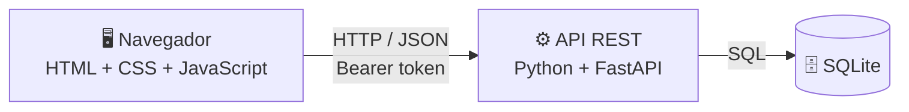
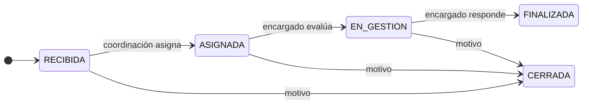
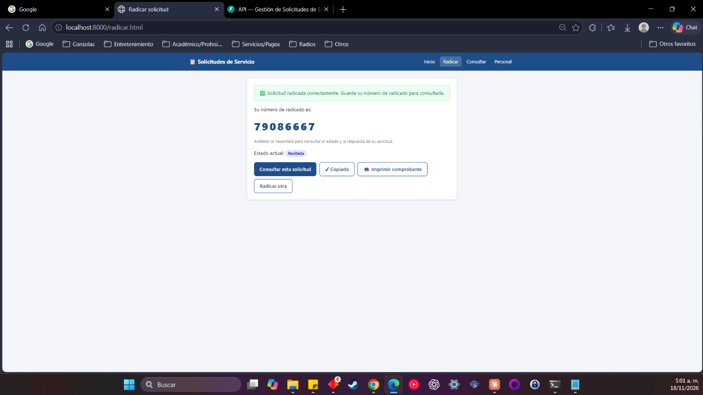
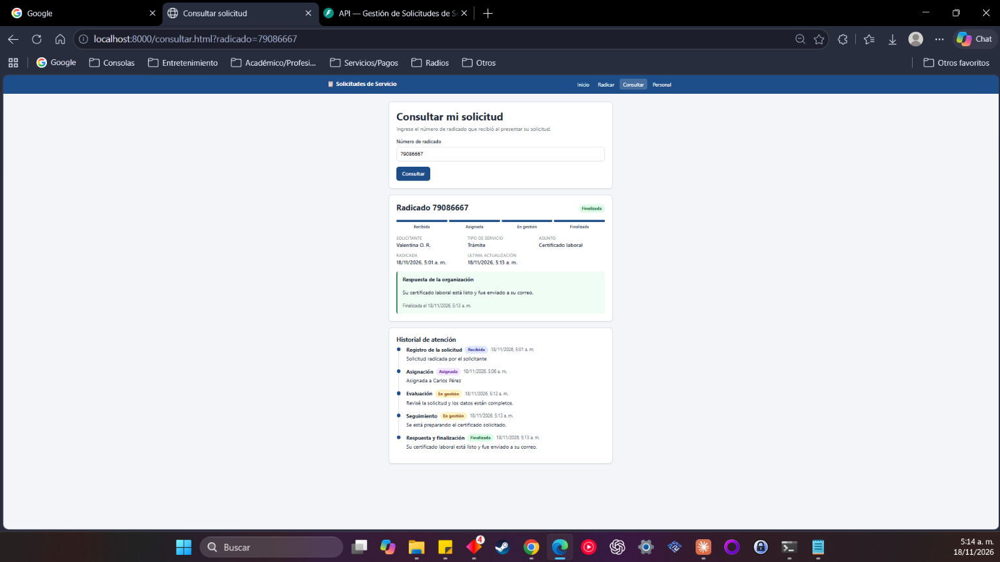
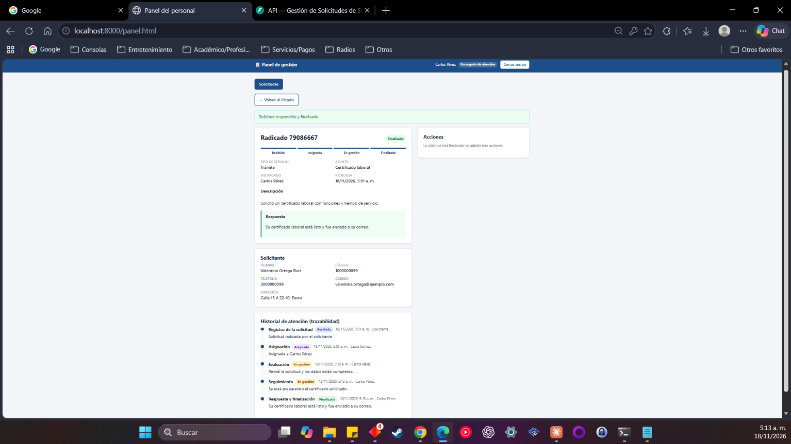
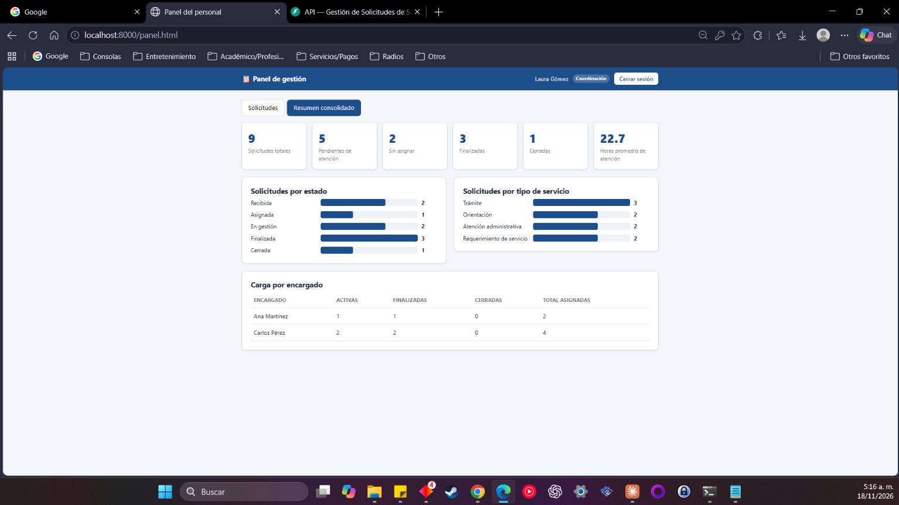

# Sistema de Gestión de Solicitudes de Servicio

Aplicación web para **recibir, evaluar, gestionar, hacer seguimiento y finalizar** solicitudes de servicio de una organización. Conserva la trazabilidad completa de cada caso. Integra una **interfaz web**, una **API REST** y una **base de datos relacional**.

---

## 1. Información general

| Campo | Valor |
|---|---|
| **Proyecto** | PF-01 — Sistema de gestión de solicitudes de servicio |
| **Asignatura** | Aplicaciones y Servicios Web — Tecnología en Desarrollo de Software |
| **Docente** | Juan Carlos Morales Guerra |
| **Integrante** | Mauricio Jojoa ([@mauricioj97](https://github.com/mauricioj97)) |
| **Fecha** | Noviembre de 2026 |
| **Repositorio** | https://github.com/mauricioj97/gestion-solicitudes-servicio |

**Contribución:** proyecto individual. Mauricio Jojoa realizó el levantamiento de requisitos, el diseño, el backend, el frontend, las pruebas y la documentación (ver sección 8).

---

## 2. Descripción del sistema

### Problema
La organización recibe solicitudes por correo, teléfono y WhatsApp. La información queda dispersa: los solicitantes no saben si su solicitud fue recibida ni en qué estado está; el personal no identifica fácilmente los casos pendientes ni lo que ya se hizo; y la coordinación no tiene información consolidada.

### Actores
| Actor | Qué hace en el sistema | ¿Inicia sesión? |
|---|---|---|
| **Solicitante** | Radica su solicitud y la consulta con su número de radicado. | No |
| **Encargado (personal de atención)** | Evalúa, hace seguimiento, responde o cierra las solicitudes que le asignan. | Sí |
| **Coordinación** | Asigna solicitudes, puede cerrarlas con motivo y consulta el resumen consolidado. | Sí |

### Alcance acordado
Recepción → asignación → evaluación → gestión con seguimiento → respuesta y finalización (o cierre con motivo). Incluye historial de acciones, consulta pública por radicado, control de acceso por rol y resumen consolidado.

**Restricciones (fuera del alcance):** facturación, pagos, WhatsApp, envío real de correos, integraciones externas, administración de usuarios desde la interfaz y eliminación de solicitudes.

Detalle completo: [docs/requisitos.md](docs/requisitos.md)

---

## 3. Requisitos y alcance

- **Método:** análisis del enunciado y entrevista al docente en el rol de cliente, con tres preguntas sobre el flujo de estados, la identificación de los actores y los datos de la solicitud.
- **Decisiones confirmadas por el cliente:**
  1. Flujo: el cliente solicita, el encargado la revisa y la responde. Se puede cerrar, **indicando el motivo**.
  2. El solicitante consulta **solo con un número**, sin cuenta. **La coordinación asigna.**
  3. Tipos de servicio del enunciado. Datos obligatorios: **nombre, cédula, dirección, teléfono y correo**.
- **Requisitos:** 15 funcionales (RF-01 a RF-15), 8 no funcionales (RNF-01 a RNF-08) y 13 reglas de negocio (RN-01 a RN-13).
- **Historias de usuario:** HU-01 a HU-07, con criterios de aceptación verificables.

El registro de la entrevista, los supuestos y la priorización están en [docs/requisitos.md](docs/requisitos.md).

---

## 4. Arquitectura, diseño de API y modelo de datos





- **Modelo de datos:** `solicitantes`, `tipos_servicio`, `solicitudes`, `acciones` (historial), `usuarios` y `sesiones`, con claves foráneas y restricciones `CHECK`/`UNIQUE`.
- **Tecnologías:** FastAPI, porque valida datos y genera documentación interactiva de la API; SQLite, porque es relacional y no requiere instalar un servidor; HTML/CSS/JS, porque no necesita compilación.
- **Diseño completo** (arquitectura, diagrama entidad-relación, permisos, secuencia, pantallas, especificación de API y decisiones técnicas): [docs/diseno.md](docs/diseno.md)

### Pantallas

| Radicar solicitud | Consulta pública |
|---|---|
|  |  |
| **Panel de gestión (detalle e historial)** | **Resumen consolidado** |
|  |  |

---

## 5. Configuración del entorno

### Requisitos
- **Python 3.10 o superior** ([python.org](https://www.python.org/downloads/)). Probado con Python 3.14 en Windows 11.
- **Git**
- Un navegador web

### Instalación (una sola vez)

```bash
git clone https://github.com/mauricioj97/gestion-solicitudes-servicio.git
cd gestion-solicitudes-servicio
python -m venv .venv
```

Activar el entorno virtual:
- Windows (PowerShell): `Set-ExecutionPolicy -Scope Process Bypass` y luego `.venv\Scripts\Activate.ps1` (el primer comando permite ejecutar el script de activación solo en esa ventana)
- Windows (CMD): `.venv\Scripts\activate.bat`
- Linux / macOS: `source .venv/bin/activate`

```bash
pip install -r backend/requirements.txt
```

### Variables de entorno (opcional)
El archivo está en `backend/` (y no en la raíz) porque el servidor se ejecuta desde esa carpeta y lo lee de ahí. Copiar `backend/.env.example` como `backend/.env` si se quiere cambiar la ruta de la base de datos (`DB_PATH`) o la duración de la sesión (`SESSION_HOURS`). Sin ese archivo se usan los valores por defecto. **No contiene secretos.**

### Preparar la base de datos y ejecutar

```bash
cd backend
python -m app.seed --reset --demo
python -m uvicorn app.main:app --reload --port 8000
```

| Qué | Dirección |
|---|---|
| Aplicación web | http://localhost:8000 |
| Documentación interactiva de la API (Swagger) | http://localhost:8000/docs |

- `--reset` borra la base de datos y la crea de nuevo.
- `--demo` carga 8 solicitudes ficticias en distintos estados.
- Sin `--demo`, solo se crean los tipos de servicio y los usuarios.

### Usuarios de prueba (ficticios)

| Usuario | Contraseña | Rol | Nombre |
|---|---|---|---|
| `coordinacion` | `Coordina2026!` | Coordinación | Laura Gómez |
| `encargado1` | `Atencion2026!` | Encargado | Carlos Pérez |
| `encargado2` | `Atencion2026!` | Encargado | Ana Martínez |

Radicados de ejemplo para consultar: `51842093` (finalizada), `64250187` (cerrada), `38571920` (en gestión) y `47702951` (recibida).

---

## 6. Servicios web implementados

| Método | Ruta | Descripción | Requisito |
|---|---|---|---|
| GET | `/api/tipos-servicio` | Lista los tipos de servicio | RF-15 |
| POST | `/api/solicitudes` | Radica una solicitud (público) | RF-01, RF-02 |
| GET | `/api/solicitudes/consulta/{radicado}` | Consulta pública por radicado | RF-03, RF-13 |
| POST | `/api/auth/login` | Inicia sesión | RF-04 |
| POST | `/api/auth/logout` | Cierra sesión | RF-04 |
| GET | `/api/auth/yo` | Usuario en sesión | RF-04 |
| GET | `/api/gestion/solicitudes` | Lista según el rol (`?estado=`) | RF-05 |
| GET | `/api/gestion/solicitudes/{id}` | Detalle completo | RF-06 |
| GET | `/api/gestion/solicitudes/{id}/historial` | Historial de acciones | RF-13 |
| POST | `/api/gestion/solicitudes/{id}/asignar` | Asigna o reasigna (coordinación) | RF-07 |
| POST | `/api/gestion/solicitudes/{id}/evaluar` | Evalúa e inicia gestión (encargado) | RF-08 |
| POST | `/api/gestion/solicitudes/{id}/seguimiento` | Nota de seguimiento (encargado) | RF-09 |
| POST | `/api/gestion/solicitudes/{id}/finalizar` | Responde y finaliza (encargado) | RF-10 |
| POST | `/api/gestion/solicitudes/{id}/cerrar` | Cierra con motivo | RF-11 |
| GET | `/api/usuarios/encargados` | Encargados activos (coordinación) | RF-15 |
| GET | `/api/reportes/resumen` | Resumen consolidado (coordinación) | RF-14 |

**Ejemplo — radicar:**

```http
POST /api/solicitudes
Content-Type: application/json

{ "nombre": "María Fernanda López", "cedula": "1000000001", "direccion": "Calle 18 # 25-40, Pasto",
  "telefono": "3000000001", "correo": "maria.lopez@ejemplo.com", "tipo_id": 1,
  "asunto": "Certificado de residencia", "descripcion": "Solicito un certificado de residencia para mi trabajo." }
```

`201 Created` → `{ "radicado": "54673067", "estado": "RECIBIDA", ... }`

**Ejemplo — error de permisos** (un encargado intenta asignar):

`403 Forbidden` → `{ "detalle": "No tiene permisos para realizar esta acción" }`

**Códigos utilizados:** 200, 201, 204, 401 (sin sesión), 403 (sin permiso), 404 (no existe), 409 (acción no válida para el estado actual), 422 (datos inválidos).

Especificación completa con formatos y errores: [docs/diseno.md, sección 9](docs/diseno.md#9-especificación-de-la-api-rest). Documentación interactiva: `http://localhost:8000/docs`.

---

## 7. Pruebas de API e integración y evidencias

**27 pruebas funcionales ejecutadas, 27 aprobadas.** Incluyen las 12 pruebas mínimas del enunciado y 15 adicionales sobre reglas de negocio y seguridad.

| # | Prueba mínima | ID | Requisitos asociados | Resultado | Código |
|---|---|---|---|---|---|
| 1 | Registro válido | PF-01 | RF-01, RN-01, RN-02 · CA-01 | ✅ | 201 |
| 2 | Registro con datos inválidos (no se guarda) | PF-02 | RF-02, RN-01 · CA-01 | ✅ | 422 |
| 3 | Consulta de solicitud existente | PF-03 | RF-03, RN-12 · CA-03 | ✅ | 200 |
| 4 | Consulta de solicitud inexistente | PF-04 | RF-03, RNF-04 | ✅ | 404 |
| 5 | Gestión por actor autorizado | PF-05 | RF-07, RN-03, RN-09 · CA-02 | ✅ | 200 |
| 6 | Gestión por actor no autorizado | PF-06 | RN-03 · CA-02 | ✅ | 403 |
| 7 | Consulta de estado coherente | PF-07 | RF-03, RN-05 · CA-03 | ✅ | 200 |
| 8 | Historial de atención | PF-08 | RF-12, RF-13, RN-09 · CA-04 | ✅ | 200 |
| 9 | Finalización y consulta del resultado | PF-09 | RF-10, RN-06 · CA-05 | ✅ | 200 |
| 10 | Consulta consolidada | PF-10 | RF-14 · CA-06 | ✅ | 200 |
| 11 | Persistencia e integridad de relaciones | PF-11 | RNF-05, RN-09 | ✅ | — |
| 12 | Integración interfaz–API–base de datos | PF-12 | RNF-01, RN-11 · CA-01 a CA-06 | ✅ | — |

Las 15 pruebas adicionales (401, 403, 409, 422 y la regla RN-13) están en la tabla de [docs/pruebas.md](docs/pruebas.md#2-resumen-de-resultados).

**Cómo reproducirlas:**
1. Manualmente en Swagger (`/docs`), siguiendo los pasos de [docs/pruebas.md](docs/pruebas.md).
2. Con el script de apoyo: con el servidor encendido y la base recién cargada (`--reset --demo`), ejecutar `python pruebas/ejecutar_pruebas.py` desde la raíz del proyecto. Repite las 26 pruebas de API (PF-12 se hace en el navegador).

**Evidencias:**
- [evidencias/resultados_pruebas_api.md](evidencias/resultados_pruebas_api.md): cada petición y su respuesta.
- [evidencias/capturas/](evidencias/capturas/): flujo completo en la interfaz y casos inválidos.

**Matriz de trazabilidad:** [docs/trazabilidad.md](docs/trazabilidad.md)

---

## 8. Control de versiones

- **Repositorio:** https://github.com/mauricioj97/gestion-solicitudes-servicio
- **Flujo de trabajo:** cada parte se desarrolló en una rama propia y se integró a `main` con un *pull request*. Cada PR documenta su propósito, los cambios, las pruebas efectuadas y los requisitos asociados.

| Rama | Contenido | Pull request |
|---|---|---|
| `docs/requisitos` | Entrevista, requisitos, reglas de negocio e historias de usuario | [#1](https://github.com/mauricioj97/gestion-solicitudes-servicio/pull/1) |
| `docs/diseno` | Arquitectura, modelo de datos, permisos y especificación de API | [#2](https://github.com/mauricioj97/gestion-solicitudes-servicio/pull/2) |
| `feature/backend-api` | Base de datos, autenticación, API REST y reglas de negocio | [#3](https://github.com/mauricioj97/gestion-solicitudes-servicio/pull/3) |
| `feature/interfaz-web` | Pantallas de radicación, consulta, ingreso y panel | [#4](https://github.com/mauricioj97/gestion-solicitudes-servicio/pull/4) |
| `test/pruebas-funcionales` | Plan de pruebas, script de apoyo y evidencias | [#5](https://github.com/mauricioj97/gestion-solicitudes-servicio/pull/5) |
| `docs/readme-trazabilidad` | Informe final y matriz de trazabilidad | [#6](https://github.com/mauricioj97/gestion-solicitudes-servicio/pull/6) |
| `feature/comprobante-radicado` | Botones para copiar el radicado e imprimir el comprobante | [#7](https://github.com/mauricioj97/gestion-solicitudes-servicio/pull/7) |
| `docs/capturas-evidencias` | Capturas de las pruebas mínimas y aportes | [#8](https://github.com/mauricioj97/gestion-solicitudes-servicio/pull/8) |

**Aportes:** Mauricio Jojoa, autor de todos los commits. Revisé y uní los PR #1 a #6, desarrollé la mejora del comprobante del radicado ([#7](https://github.com/mauricioj97/gestion-solicitudes-servicio/pull/7)) y ejecuté las pruebas mínimas con sus capturas ([#8](https://github.com/mauricioj97/gestion-solicitudes-servicio/pull/8)). El detalle de cada cambio está en el [historial de commits](https://github.com/mauricioj97/gestion-solicitudes-servicio/commits/main).
---

## 9. Conclusiones y limitaciones

### Cumplimiento
Se cumplen las seis condiciones obligatorias. CA-01 a CA-06 se demuestran con un flujo completo desde la interfaz hasta la base de datos (ver [trazabilidad](docs/trazabilidad.md)). Las reglas de negocio y los permisos se validan en el servidor, así que se respetan aunque se use la API sin la interfaz.

### Dificultades y soluciones
| Dificultad | Solución |
|---|---|
| El solicitante consulta sin cuenta: cualquiera con un número podría ver una solicitud ajena. | Radicado aleatorio de 8 dígitos (no consecutivo) y vista pública sin cédula, dirección, teléfono ni correo. |
| Evitar estados incoherentes (por ejemplo, finalizar sin evaluar). | Máquina de estados centralizada que responde 409 ante transiciones no permitidas. |
| Que el historial y el estado no quedaran desincronizados. | Cambio de estado y registro de la acción en una sola transacción. |
| En la revisión se detectó que radicar con una cédula ya registrada sobrescribía los datos de otra persona. | Cada radicación guarda su propia copia de los datos del solicitante (RN-13), verificado con la prueba PF-20. |
| Los mensajes de validación del framework salían en inglés. | Manejadores de error propios que responden en español e indican el campo con error. |

### Limitaciones
- No se envían notificaciones por correo (fuera del alcance). El solicitante debe consultar con su radicado.
- Los usuarios del personal se crean con el script de datos iniciales; no hay pantalla para administrarlos.
- SQLite es adecuado para el volumen del proyecto; para muchos usuarios simultáneos convendría un motor como PostgreSQL.
