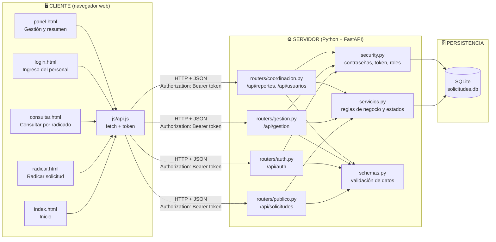
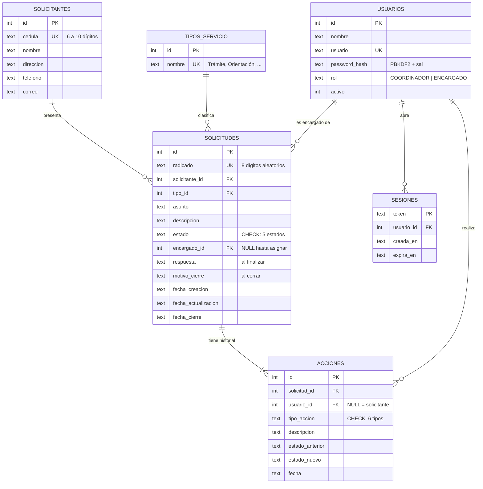
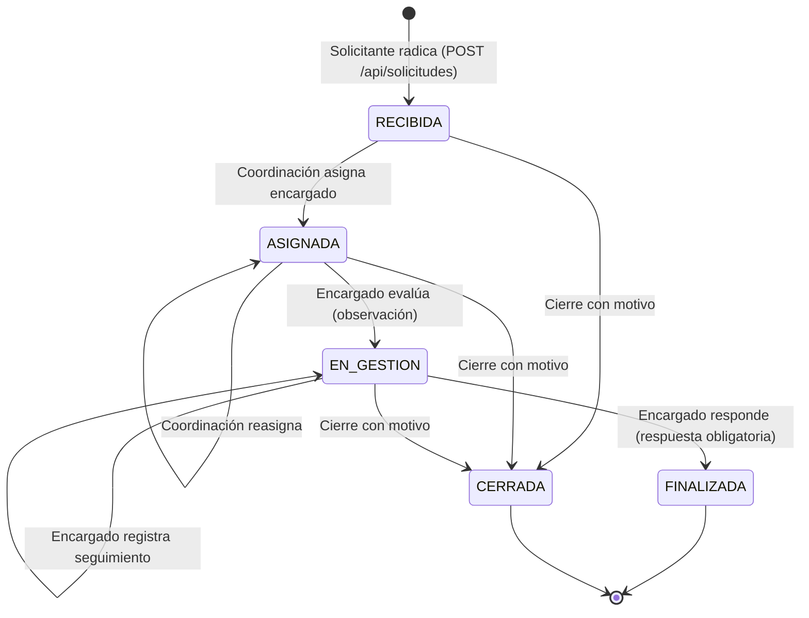
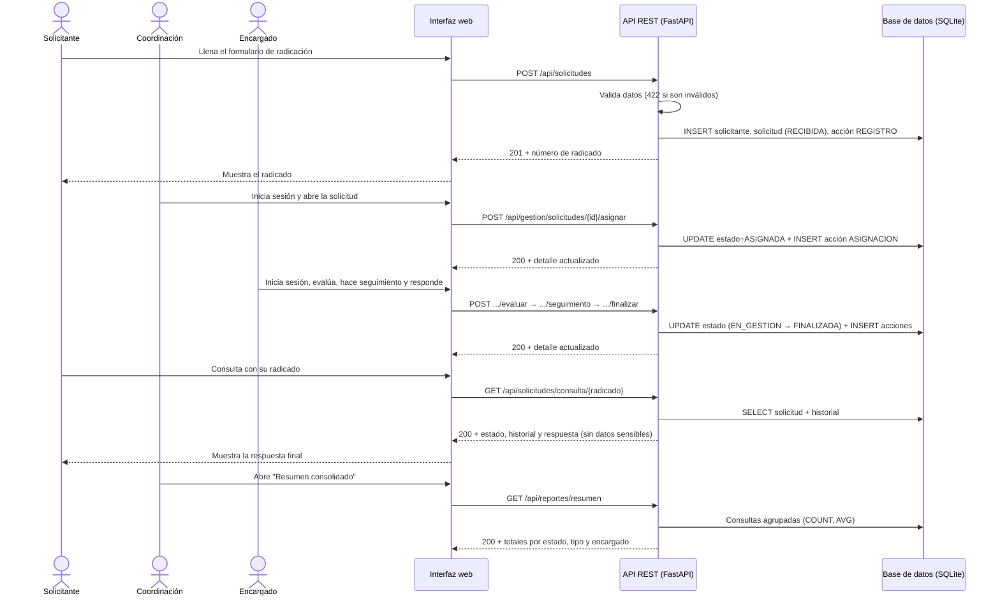

# Diseño de la Aplicación y de los Servicios Web

Este documento describe **cómo** se construyó la solución definida en [requisitos.md](requisitos.md): arquitectura, tecnologías, modelo de datos, flujo de estados, permisos, interfaces y especificación de la API REST.

---

## 1. Arquitectura cliente-servidor



| Capa | Responsabilidad | Archivos |
|---|---|---|
| **Frontend** | Muestra pantallas, valida datos antes de enviarlos, consume la API con `fetch` y guarda el token de sesión en `sessionStorage`. | `frontend/` |
| **API REST** | Recibe las peticiones HTTP, valida datos, verifica sesión y rol, aplica reglas de negocio y responde en JSON con el código HTTP adecuado. | `backend/app/routers/`, `schemas.py`, `security.py`, `servicios.py`, `main.py` |
| **Persistencia** | Guarda solicitantes, solicitudes, historial, usuarios y sesiones, con claves foráneas y restricciones. | `backend/app/schema.sql`, `database.py` |

La interfaz web la entrega el mismo servidor (en `/`) y la API responde en `/api/...`. Por eso una sola instrucción levanta toda la aplicación y no se necesita configurar CORS. Aun así, el frontend y el backend siguen siendo componentes separados que se comunican solo por HTTP.

---

## 2. Tecnologías seleccionadas y justificación

| Componente | Tecnología | Justificación |
|---|---|---|
| Lenguaje backend | **Python 3.12+** | Sintaxis clara y librería estándar con soporte para SQLite y criptografía (`hashlib`, `secrets`). |
| Framework backend | **FastAPI** | Crea APIs REST con poco código, valida datos con Pydantic y genera **documentación interactiva** (Swagger UI en `/docs`), que se usa para las pruebas funcionales. |
| Servidor | **Uvicorn** | Servidor ASGI recomendado para FastAPI. |
| Base de datos | **SQLite** | Base de datos relacional en un solo archivo: no requiere instalar un servidor, soporta claves foráneas, `CHECK`, `UNIQUE` y transacciones. Suficiente para el volumen del proyecto. |
| Frontend | **HTML5, CSS3 y JavaScript** | No requiere compilación ni dependencias. Permite ver directamente cómo se consume la API con `fetch`. |
| Control de versiones | **Git y GitHub** | Ramas, commits descriptivos y *pull requests*. |

---

## 3. Organización del proyecto

```text
gestion-solicitudes-servicio/
├── backend/
│   ├── app/
│   │   ├── main.py            # Crea la app, registra rutas, manejo de errores y sirve el frontend
│   │   ├── config.py          # Variables de entorno (.env)
│   │   ├── database.py        # Conexión SQLite y creación de tablas
│   │   ├── schema.sql         # Definición de tablas, claves y restricciones
│   │   ├── schemas.py         # Modelos de entrada y validaciones
│   │   ├── security.py        # Hash de contraseñas, sesiones y control por rol
│   │   ├── servicios.py       # Reglas de negocio: estados, historial, vistas
│   │   ├── seed.py            # Datos ficticios (usuarios y solicitudes de ejemplo)
│   │   └── routers/           # Endpoints agrupados por actor
│   │       ├── publico.py     # Solicitante (sin cuenta)
│   │       ├── auth.py        # Inicio y cierre de sesión
│   │       ├── gestion.py     # Coordinación y encargados
│   │       └── coordinacion.py# Encargados disponibles y resumen consolidado
│   ├── requirements.txt
│   └── .env.example
├── frontend/                  # Interfaz web (HTML, CSS, JS)
├── docs/                      # Requisitos, diseño, pruebas y trazabilidad
├── pruebas/                   # Script que repite las pruebas y genera evidencia
└── evidencias/                # Resultados y capturas de pantalla
```

Las rutas se agrupan **por actor** (público, autenticación, gestión, coordinación). Las reglas de negocio están en `servicios.py`, separadas de las rutas, para que una misma regla (por ejemplo, la máquina de estados) se aplique igual en todos los endpoints.

---

## 4. Modelo de datos



### Diccionario de datos (tablas principales)

| Tabla | Para qué sirve | Restricciones clave |
|---|---|---|
| `solicitantes` | Datos de contacto de quien solicita. Una persona puede tener varias solicitudes. | `cedula UNIQUE` |
| `tipos_servicio` | Lista fija de tipos de servicio. | `nombre UNIQUE` |
| `solicitudes` | La solicitud, su estado actual, su encargado y su resultado. | `radicado UNIQUE`, `estado CHECK`, FK a solicitante, tipo y usuario |
| `acciones` | **Historial (trazabilidad)**: una fila por cada acción realizada sobre una solicitud. Nunca se edita ni se borra. | FK a solicitud (obligatoria) y a usuario, `tipo_accion CHECK` |
| `usuarios` | Personal que inicia sesión. La contraseña se guarda solo como hash. | `usuario UNIQUE`, `rol CHECK` |
| `sesiones` | Tokens de sesión activos con fecha de vencimiento. | FK a usuario |

El script de creación está en [`backend/app/schema.sql`](../backend/app/schema.sql). Se activa `PRAGMA foreign_keys = ON` en cada conexión, de modo que la base de datos rechaza referencias inexistentes (por ejemplo, una acción de una solicitud que no existe).

---

## 5. Flujo de estados de la solicitud



Cualquier transición que no aparezca en el diagrama se rechaza con **HTTP 409 Conflict**. Por ejemplo: finalizar una solicitud que no ha sido evaluada, o cerrar una que ya está finalizada. La regla está en `TRANSICIONES` y `validar_transicion()` de [`servicios.py`](../backend/app/servicios.py).

Cada cambio de estado y su registro en el historial se guardan en **una sola transacción** (`aplicar_accion()`): o se guardan ambos o ninguno.

---

## 6. Actores, permisos y control de acceso

| Operación | Solicitante (sin cuenta) | Encargado | Coordinación |
|---|:---:|:---:|:---:|
| Radicar solicitud | ✅ | — | — |
| Consultar por radicado (vista pública) | ✅ | ✅ | ✅ |
| Iniciar sesión | — | ✅ | ✅ |
| Listar solicitudes | — | Solo las asignadas a él | Todas |
| Ver detalle e historial | — | Solo las asignadas a él | Todas |
| Asignar o reasignar encargado | — | ❌ 403 | ✅ |
| Evaluar, registrar seguimiento, finalizar | — | ✅ (si es el asignado) | ❌ 403 |
| Cerrar con motivo | — | ✅ (si es el asignado) | ✅ |
| Resumen consolidado | — | ❌ 403 | ✅ |

**Cómo se aplica:**
1. **Autenticación:** `POST /api/auth/login` verifica la contraseña contra su hash PBKDF2 y entrega un token aleatorio que vence en 8 horas. El frontend lo envía en cada petición con el encabezado `Authorization: Bearer <token>`.
2. **Autorización por rol:** la dependencia `requiere_rol()` de [`security.py`](../backend/app/security.py) responde **403** si el rol no tiene permiso.
3. **Autorización por pertenencia:** `verificar_acceso()` de [`servicios.py`](../backend/app/servicios.py) responde **403** si un encargado intenta acceder a una solicitud asignada a otra persona.
4. Los permisos se validan **en el servidor**. Ocultar botones en la interfaz es solo comodidad: una petición enviada sin la interfaz (por ejemplo, desde Swagger) también se bloquea.

---

## 7. Recorridos de los actores (integración completa)



---

## 8. Interfaces (pantallas)

| Pantalla | Archivo | Actor | Qué permite | Endpoints que consume |
|---|---|---|---|---|
| Inicio | `index.html` | Todos | Elegir entre radicar, consultar o ingresar como personal. | — |
| Radicar | `radicar.html` | Solicitante | Formulario con validación en el navegador; muestra el radicado al terminar. | `GET /api/tipos-servicio`, `POST /api/solicitudes` |
| Consultar | `consultar.html` | Solicitante | Buscar por radicado; ver estado, barra de progreso, historial y respuesta o motivo de cierre. | `GET /api/solicitudes/consulta/{radicado}` |
| Ingreso | `login.html` | Personal | Iniciar sesión con usuario y contraseña. | `POST /api/auth/login` |
| Panel – listado | `panel.html` | Personal | Tabla de solicitudes con filtro por estado (la coordinación ve todas; el encargado, solo las suyas). | `GET /api/gestion/solicitudes` |
| Panel – detalle | `panel.html` | Personal | Datos completos, historial y **solo las acciones que el rol y el estado permiten**. | `GET /api/gestion/solicitudes/{id}`, `POST .../asignar`, `.../evaluar`, `.../seguimiento`, `.../finalizar`, `.../cerrar`, `GET /api/usuarios/encargados` |
| Panel – resumen | `panel.html` | Coordinación | Indicadores, gráficas de barras por estado y por tipo, y carga por encargado. | `GET /api/reportes/resumen` |

Las capturas de cada pantalla están en [`evidencias/capturas/`](../evidencias/capturas/).

---

## 9. Especificación de la API REST

**URL base:** `http://localhost:8000` · **Documentación interactiva:** `http://localhost:8000/docs` · **Formato:** JSON (UTF-8)

| # | Método | Ruta | Acceso | Descripción | Respuesta OK | Errores posibles |
|---|---|---|---|---|---|---|
| 1 | GET | `/api/tipos-servicio` | Público | Lista los tipos de servicio | 200 | — |
| 2 | POST | `/api/solicitudes` | Público | Radica una solicitud | 201 | 422 |
| 3 | GET | `/api/solicitudes/consulta/{radicado}` | Público | Vista pública de una solicitud | 200 | 404 |
| 4 | POST | `/api/auth/login` | Público | Inicia sesión y entrega un token | 200 | 401, 422 |
| 5 | POST | `/api/auth/logout` | Personal | Cierra la sesión | 204 | 401 |
| 6 | GET | `/api/auth/yo` | Personal | Datos del usuario en sesión | 200 | 401 |
| 7 | GET | `/api/gestion/solicitudes?estado=` | Personal | Lista según el rol, con filtro opcional | 200 | 401, 403, 422 |
| 8 | GET | `/api/gestion/solicitudes/{id}` | Personal | Detalle completo con historial | 200 | 401, 403, 404 |
| 9 | GET | `/api/gestion/solicitudes/{id}/historial` | Personal | Solo el historial | 200 | 401, 403, 404 |
| 10 | POST | `/api/gestion/solicitudes/{id}/asignar` | Coordinación | Asigna o reasigna encargado | 200 | 401, 403, 404, 409, 422 |
| 11 | POST | `/api/gestion/solicitudes/{id}/evaluar` | Encargado asignado | Evalúa y pasa a En gestión | 200 | 401, 403, 404, 409, 422 |
| 12 | POST | `/api/gestion/solicitudes/{id}/seguimiento` | Encargado asignado | Agrega nota de seguimiento | 200 | 401, 403, 404, 409, 422 |
| 13 | POST | `/api/gestion/solicitudes/{id}/finalizar` | Encargado asignado | Responde y finaliza | 200 | 401, 403, 404, 409, 422 |
| 14 | POST | `/api/gestion/solicitudes/{id}/cerrar` | Coordinación o encargado asignado | Cierra con motivo | 200 | 401, 403, 404, 409, 422 |
| 15 | GET | `/api/usuarios/encargados` | Coordinación | Encargados activos y su carga | 200 | 401, 403 |
| 16 | GET | `/api/reportes/resumen` | Coordinación | Resumen consolidado | 200 | 401, 403 |

### ¿Por qué no hay un CRUD completo?

- **No existe `DELETE` de solicitudes ni del historial:** borrar rompería la trazabilidad (RN-10).
- **No existe `PUT` para editar una solicitud:** la solicitud cambia solo mediante **acciones del proceso** (asignar, evaluar, seguimiento, finalizar, cerrar). Cada acción es un `POST` a un subrecurso, porque crea un nuevo registro en el historial y aplica una transición de estado validada. Por eso no se usa un `PATCH` genérico, que permitiría saltarse el flujo.

### Significado de los códigos HTTP

| Código | Cuándo se usa en esta API |
|---|---|
| 200 OK | Consulta o acción realizada correctamente. |
| 201 Created | Solicitud radicada. |
| 204 No Content | Sesión cerrada. |
| 401 Unauthorized | No envió token, el token es inválido o venció, o las credenciales son incorrectas. |
| 403 Forbidden | Tiene sesión, pero su rol no permite la acción o la solicitud está asignada a otro encargado. |
| 404 Not Found | La solicitud (por radicado o id) no existe. |
| 409 Conflict | La acción no es válida para el estado actual (regla de negocio del flujo). |
| 422 Unprocessable Content | Datos faltantes o con formato inválido. |
| 500 Internal Server Error | Error inesperado. El cliente solo recibe "Error interno del servidor" y el detalle queda en el registro del servidor. |

### Formato de errores (siempre en español)

```json
{ "detalle": "No tiene permisos para realizar esta acción" }
```

Errores de validación (422), indicando cada campo:

```json
{
  "detalle": "Los datos enviados no son válidos",
  "errores": [
    { "campo": "cedula", "mensaje": "El campo cédula debe tener solo números, entre 6 y 10 dígitos" },
    { "campo": "correo", "mensaje": "El campo correo no tiene un formato válido (ejemplo: nombre@dominio.com)" }
  ]
}
```

### Ejemplos de solicitud y respuesta

**Radicar — `POST /api/solicitudes`**

```json
{
  "nombre": "María Fernanda López",
  "cedula": "1085123456",
  "direccion": "Calle 18 # 25-40, Pasto",
  "telefono": "3104567890",
  "correo": "maria.lopez@correo.com",
  "tipo_id": 1,
  "asunto": "Certificado de residencia",
  "descripcion": "Solicito un certificado de residencia para presentar en mi trabajo."
}
```

Respuesta `201 Created` (resumida):

```json
{
  "mensaje": "Solicitud radicada correctamente. Guarde su número de radicado para consultarla.",
  "radicado": "54673067",
  "solicitante": "María F. L.",
  "tipo": "Trámite",
  "estado": "RECIBIDA",
  "estado_etiqueta": "Recibida",
  "historial": [
    { "fecha": "2026-11-16 10:24:11", "accion": "REGISTRO", "descripcion": "Solicitud radicada por el solicitante", "estado_nuevo": "RECIBIDA" }
  ]
}
```

**Iniciar sesión — `POST /api/auth/login`**

```json
{ "usuario": "coordinacion", "contrasena": "(ver README, credenciales de prueba)" }
```

Respuesta `200 OK`:

```json
{
  "token": "Qm9f...aleatorio...",
  "tipo": "Bearer",
  "expira_en": "2026-11-16 18:30:00",
  "usuario": { "id": 1, "nombre": "Laura Gómez", "usuario": "coordinacion", "rol": "COORDINADOR" }
}
```

**Asignar — `POST /api/gestion/solicitudes/9/asignar`** (encabezado `Authorization: Bearer <token>`)

```json
{ "encargado_id": 2 }
```

**Evaluar / seguimiento / finalizar / cerrar** (cuerpo según la acción):

```json
{ "observacion": "Solicitud revisada: la información está completa y procede." }
{ "nota": "Se verificaron los datos en el sistema interno." }
{ "respuesta": "Su certificado fue expedido y puede reclamarlo en la sede principal." }
{ "motivo": "Solicitud duplicada: ya existe el radicado 51842093." }
```

**Resumen — `GET /api/reportes/resumen`** (respuesta resumida)

```json
{
  "total": 9, "pendientes": 6, "sin_asignar": 2, "finalizadas": 2, "cerradas": 1,
  "tiempo_promedio_atencion_horas": 34.0,
  "por_estado": [{ "estado": "RECIBIDA", "etiqueta": "Recibida", "cantidad": 2 }],
  "por_tipo": [{ "tipo": "Trámite", "cantidad": 3 }],
  "por_encargado": [{ "encargado": "Carlos Pérez", "activas": 3, "finalizadas": 1, "cerradas": 0, "total": 4 }]
}
```

---

## 10. Dónde se aplica cada regla de negocio

| Regla | Dónde se implementa |
|---|---|
| RN-01 Validaciones de datos | `schemas.py` (`SolicitudCrear` y modelos de acciones) y `radicar.js` (en el navegador) |
| RN-02 Estado inicial y radicado único | `routers/publico.py` → `radicar()`, `servicios.generar_radicado()`, `UNIQUE` en BD |
| RN-03 Solo coordinación asigna | `routers/gestion.py` → `asignar()` con `requiere_rol("COORDINADOR")` |
| RN-04 Solo el encargado asignado gestiona | `requiere_rol("ENCARGADO")` + `servicios.verificar_acceso()` |
| RN-05 Transiciones permitidas | `servicios.TRANSICIONES` y `validar_transicion()` → 409 |
| RN-06 / RN-07 Respuesta y motivo obligatorios | `FinalizarEntrada` y `CerrarEntrada` en `schemas.py` → 422 |
| RN-08 Estados finales sin acciones | `validar_transicion()` → 409 |
| RN-09 Historial automático | `servicios.aplicar_accion()` (transacción) y `registrar_accion()` |
| RN-10 Sin eliminación | No existe endpoint `DELETE` |
| RN-11 Visibilidad por rol | `routers/gestion.py` → `listar()` filtra por `encargado_id` |
| RN-12 Privacidad en consulta pública | `servicios.vista_publica()` y `enmascarar_nombre()` |

---

## 11. Decisiones técnicas

| # | Decisión | Motivo | Requisito |
|---|---|---|---|
| D-01 | El solicitante no tiene cuenta; consulta con un radicado aleatorio de 8 dígitos. | Así lo pidió el cliente. El número aleatorio evita que se puedan adivinar radicados consecutivos. | RF-03, SUP-02 |
| D-02 | Las acciones del proceso son endpoints `POST` separados, no un `PUT`/`PATCH` genérico. | Cada acción tiene su propia regla, su propio permiso y su registro en el historial. | RN-05, RN-09 |
| D-03 | Token de sesión aleatorio guardado en la tabla `sesiones` (no JWT). | Permite cerrar sesión de verdad (se borra el token) y es fácil de explicar. | RF-04, RNF-02 |
| D-04 | Contraseñas con PBKDF2-SHA256, sal aleatoria y 200 000 iteraciones (librería estándar). | No se guardan contraseñas en texto plano y no se requieren librerías extra. | RNF-02 |
| D-05 | SQLite con `PRAGMA foreign_keys = ON` y transacciones. | Integridad referencial sin instalar un servidor de base de datos. | RNF-05 |
| D-06 | El frontend lo sirve el mismo servidor. | Una sola instrucción para ejecutar todo, sin configurar CORS. | RNF-07 |
| D-07 | Mensajes de error propios en español; los errores 500 no muestran detalles internos. | Claridad para el usuario y no se revela información sensible. | RNF-04 |
| D-08 | Validación en el navegador **y** en el servidor. | La del navegador da comodidad; la del servidor protege los datos aunque se use la API directamente. | RN-01 |
