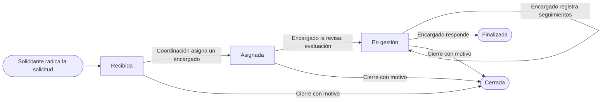

# Requisitos — Sistema de Gestión de Solicitudes de Servicio

Este documento define **qué** se implementa en la aplicación y sirve de base para el diseño, el desarrollo y las pruebas. Las condiciones obligatorias CA-01 a CA-06 del enunciado están incluidas y relacionadas con cada requisito.

---

## 1. Método de levantamiento de información

1. Lectura y análisis del enunciado del proyecto (contexto, situación actual, actores, problema, límites del alcance y condiciones CA-01 a CA-06).
2. Preparación de tres preguntas enfocadas en los vacíos que el enunciado deja al equipo: **flujo de estados**, **identificación y permisos** e **información de la solicitud**.
3. Entrevista con el docente en el rol de representante de la organización (respuestas recibidas por mensaje escrito).
4. Registro de respuestas, acuerdos, supuestos y cuestiones pendientes (sección 2).
5. Formulación de requisitos, reglas de negocio, historias de usuario y criterios de aceptación (secciones 3 a 8).

---

## 2. Registro de la entrevista

| Campo | Valor |
|---|---|
| Entrevistado | Docente Juan Carlos Morales Guerra, en el rol de representante de la organización (cliente) |
| Medio | Mensaje escrito (chat del curso) |
| Fecha de respuesta | 10-11-2026 |
| Entrevistador | Mauricio Jojoa |

### Preguntas y respuestas

| # | Pregunta | Respuesta del cliente | Qué se definió con la respuesta |
|---|---|---|---|
| P1 | ¿Por qué estados pasa una solicitud desde que se recibe hasta que se finaliza, y en qué momentos puede rechazarse o cerrarse sin atenderla? | "El cliente solicita, luego el encargado la revisa y la responde. Sí se puede cerrar, pero hay que decir por qué." | Flujo: **Recibida → Asignada → En gestión → Finalizada**. Existe el estado **Cerrada**, que exige un **motivo obligatorio**. |
| P2 | ¿Cómo se identifica el solicitante para registrar y consultar su solicitud? ¿Cualquier persona del personal puede gestionar cualquier solicitud o la coordinación las asigna? | "Lo ideal es que cualquier usuario pueda consultar solo con un número, sin requerir una cuenta. La coordinación asigna." | El solicitante **no necesita cuenta**: recibe un **número de radicado** y consulta con él. Solo el personal inicia sesión. **La coordinación asigna** cada solicitud a un encargado. |
| P3 | ¿Qué datos debe aportar el solicitante y cuáles son obligatorios? ¿Los tipos de servicio son una lista fija? | "Los tipos son los de la descripción. Nombre, cédula, dirección, teléfono y correo." | Tipos fijos: **Trámite, Orientación, Atención administrativa, Requerimiento de servicio**. Datos obligatorios del solicitante: **nombre, cédula, dirección, teléfono y correo**. |

### Acuerdos

- **A-01.** El solicitante radica y consulta sin cuenta, usando el número de radicado que entrega el sistema.
- **A-02.** Solo la coordinación asigna (o reasigna) solicitudes al personal de atención.
- **A-03.** El encargado asignado revisa (evalúa), gestiona y responde la solicitud.
- **A-04.** Una solicitud puede cerrarse sin respuesta, pero siempre registrando el motivo.
- **A-05.** Los tipos de servicio son una lista fija tomada del enunciado.

### Supuestos (no confirmados por el cliente, propuestos por el desarrollador)

| ID | Supuesto | Justificación |
|---|---|---|
| SUP-01 | Además de los datos personales, la solicitud tiene **asunto** y **descripción** obligatorios. | Sin ellos el encargado no puede saber qué se pide. |
| SUP-02 | El número de radicado es un **número aleatorio de 8 dígitos** (no consecutivo). | Si fuera consecutivo, cualquiera podría adivinar radicados ajenos, ya que la consulta no pide cuenta. |
| SUP-03 | La consulta pública **no muestra** cédula, dirección, teléfono ni correo completos. | Protege los datos personales, porque basta el número para consultar. |
| SUP-04 | Las notas de seguimiento son visibles para el solicitante en el historial. | Mantiene informado al solicitante (problema de la situación actual). |
| SUP-05 | La coordinación también puede cerrar solicitudes (con motivo), por ejemplo, solicitudes duplicadas que aún no se han asignado. | Evita solicitudes "huérfanas" en estado Recibida. |
| SUP-06 | Los usuarios del personal se crean con un script de datos iniciales; no se incluye un módulo de administración de usuarios. | No hace parte de las condiciones obligatorias; reduce el alcance. |

### Cuestiones pendientes

- Posibles notificaciones por correo al solicitante: quedan **fuera del alcance** (el enunciado excluye envíos reales de correo).

---

## 3. Actores

| Actor | Descripción | ¿Inicia sesión? |
|---|---|---|
| **Solicitante** | Persona interna o externa que presenta una necesidad de servicio. | No. Usa el número de radicado. |
| **Personal de atención (encargado)** | Revisa, gestiona, responde o cierra las solicitudes **que le asignaron**. | Sí. Rol `ENCARGADO`. |
| **Coordinación** | Asigna solicitudes, supervisa el proceso y consulta el resumen consolidado. | Sí. Rol `COORDINADOR`. |

---

## 4. Proceso de atención

| Etapa del enunciado | Cómo se cumple en el sistema |
|---|---|
| Recepción | El solicitante radica → estado **Recibida**. |
| Evaluación | Coordinación asigna (**Asignada**) y el encargado revisa la solicitud registrando una observación → **En gestión**. |
| Gestión | El encargado trabaja la solicitud y registra notas de seguimiento. |
| Seguimiento | Solicitante y personal consultan el estado y el historial en todo momento. |
| Finalización | El encargado responde (**Finalizada**) o se cierra con motivo (**Cerrada**). |

---

## 5. Reglas de negocio

| ID | Regla |
|---|---|
| RN-01 | Para radicar son obligatorios: nombre, cédula, dirección, teléfono, correo, tipo de servicio, asunto y descripción, con formato válido (ver sección 9). |
| RN-02 | Toda solicitud nueva inicia en estado **Recibida** y recibe un número de radicado único. |
| RN-03 | Solo la **coordinación** asigna o reasigna solicitudes, y solo a usuarios activos con rol de personal de atención. Se permite asignar en estado Recibida o Asignada. |
| RN-04 | Solo el **encargado asignado** puede evaluar, registrar seguimientos y finalizar su solicitud. |
| RN-05 | Solo se permiten estas transiciones: Recibida→Asignada, Asignada→En gestión, En gestión→Finalizada, y Recibida/Asignada/En gestión→Cerrada. Cualquier otra se rechaza. |
| RN-06 | Finalizar exige una **respuesta** (mínimo 10 caracteres). |
| RN-07 | Cerrar exige un **motivo** (mínimo 10 caracteres). Pueden cerrar la coordinación o el encargado asignado. |
| RN-08 | Las solicitudes **Finalizadas** o **Cerradas** no admiten más acciones. |
| RN-09 | Cada acción queda registrada automáticamente en el historial con fecha, responsable, estado anterior, estado nuevo y descripción. El historial no se edita ni se elimina. |
| RN-10 | Las solicitudes no se eliminan: se conserva la trazabilidad completa. |
| RN-11 | El personal de atención solo ve las solicitudes que tiene asignadas; la coordinación ve todas. |
| RN-12 | La consulta pública por radicado muestra solo información no sensible del solicitante. |

---

## 6. Requisitos funcionales

| ID | Requisito | Actor | Condición | Prioridad |
|---|---|---|---|---|
| RF-01 | Radicar una solicitud con datos del solicitante, tipo de servicio, asunto y descripción; el sistema entrega el número de radicado. | Solicitante | CA-01 | Debe |
| RF-02 | Validar en el servidor los datos de la solicitud y rechazar datos inválidos sin guardarlos. | Sistema | CA-01 | Debe |
| RF-03 | Consultar una solicitud con el número de radicado, sin cuenta: estado, historial, respuesta o motivo de cierre. | Solicitante | CA-03, CA-05 | Debe |
| RF-04 | Iniciar y cerrar sesión del personal con usuario y contraseña. | Personal, Coordinación | CA-02 | Debe |
| RF-05 | Listar solicitudes según el rol (todas o solo las asignadas), con filtro por estado. | Personal, Coordinación | CA-02 | Debe |
| RF-06 | Ver el detalle completo de una solicitud (datos, estado, encargado e historial). | Personal, Coordinación | CA-03 | Debe |
| RF-07 | Asignar o reasignar una solicitud a un encargado. | Coordinación | CA-02 | Debe |
| RF-08 | Evaluar (revisar) una solicitud asignada registrando una observación, lo que la pasa a En gestión. | Personal | CA-02 | Debe |
| RF-09 | Registrar notas de seguimiento durante la gestión. | Personal | CA-02, CA-04 | Debe |
| RF-10 | Responder y finalizar una solicitud con una respuesta obligatoria. | Personal | CA-05 | Debe |
| RF-11 | Cerrar una solicitud indicando el motivo. | Personal, Coordinación | CA-02, CA-05 | Debe |
| RF-12 | Registrar automáticamente en el historial cada acción realizada. | Sistema | CA-04 | Debe |
| RF-13 | Consultar el historial de acciones de una solicitud. | Todos | CA-04 | Debe |
| RF-14 | Consultar un resumen consolidado: total de solicitudes, cantidad por estado, por tipo de servicio y por encargado, pendientes y tiempo promedio de atención. | Coordinación | CA-06 | Debe |
| RF-15 | Listar los tipos de servicio disponibles y los encargados activos (para asignar). | Sistema | CA-01, CA-02 | Debería |

## 7. Requisitos no funcionales

| ID | Requisito |
|---|---|
| RNF-01 | Arquitectura cliente-servidor: interfaz web (HTML, CSS, JavaScript), API REST (Python + FastAPI) y base de datos relacional (SQLite). |
| RNF-02 | Seguridad: contraseñas guardadas con hash (PBKDF2 con sal), token de sesión con vencimiento (8 horas) y permisos validados en el servidor, no solo en la interfaz. |
| RNF-03 | Privacidad: la consulta pública enmascara el nombre y no muestra cédula, dirección, teléfono ni correo. |
| RNF-04 | La API responde en JSON con códigos HTTP coherentes (200, 201, 204, 401, 403, 404, 409, 422) y mensajes de error en español, sin revelar información interna. |
| RNF-05 | Integridad de datos: claves primarias y foráneas, restricciones `CHECK` y `UNIQUE`, y transacciones al cambiar estado y registrar historial. |
| RNF-06 | Usabilidad: interfaz en español, adaptable a celular y computador, con mensajes claros de éxito y error. |
| RNF-07 | Reproducibilidad: instalación y ejecución documentadas en el README, sin secretos en el repositorio y con datos de prueba ficticios. |
| RNF-08 | Documentación interactiva de la API disponible en `/docs` (Swagger UI). |

---

## 8. Historias de usuario y criterios de aceptación

### HU-01 — Radicar solicitud (RF-01, RF-02 · CA-01)
**Como** solicitante, **quiero** registrar mi solicitud de servicio **para** que la organización la atienda.
- **CA-HU01-1:** Dado que diligencio todos los datos válidos, cuando envío el formulario, entonces el sistema guarda la solicitud en estado *Recibida* y me muestra un número de radicado de 8 dígitos.
- **CA-HU01-2:** Dado que dejo un campo obligatorio vacío o con formato inválido (por ejemplo, un correo sin "@"), cuando envío, entonces el sistema rechaza la solicitud (HTTP 422), indica el campo con error y no guarda nada.

### HU-02 — Consultar mi solicitud (RF-03, RF-13 · CA-03, CA-05)
**Como** solicitante, **quiero** consultar mi solicitud con el número de radicado **para** conocer su estado y la respuesta.
- **CA-HU02-1:** Dado un radicado existente, cuando lo consulto, entonces veo el tipo, el asunto, el estado actual y el historial de acciones.
- **CA-HU02-2:** Dado un radicado inexistente, cuando lo consulto, entonces el sistema responde "Solicitud no encontrada" (HTTP 404).
- **CA-HU02-3:** Dada una solicitud finalizada o cerrada, cuando la consulto, entonces veo la respuesta o el motivo de cierre.
- **CA-HU02-4:** La consulta no muestra mi cédula, dirección, teléfono ni correo.

### HU-03 — Iniciar sesión (RF-04 · CA-02)
**Como** miembro del personal, **quiero** iniciar sesión **para** acceder a las funciones de mi rol.
- **CA-HU03-1:** Con usuario y contraseña correctos, ingreso al panel según mi rol.
- **CA-HU03-2:** Con credenciales incorrectas, el sistema responde "Usuario o contraseña incorrectos" (HTTP 401).
- **CA-HU03-3:** Sin sesión, cualquier operación de gestión responde HTTP 401.

### HU-04 — Asignar solicitud (RF-05, RF-07 · CA-02)
**Como** coordinación, **quiero** asignar cada solicitud recibida a un encargado **para** que sea atendida.
- **CA-HU04-1:** Dada una solicitud *Recibida*, cuando la asigno a un encargado, entonces pasa a *Asignada* y queda registrada la acción en el historial.
- **CA-HU04-2:** Si un encargado intenta asignar, el sistema lo impide (HTTP 403).
- **CA-HU04-3:** Si la solicitud ya está *En gestión*, *Finalizada* o *Cerrada*, la asignación se rechaza (HTTP 409).

### HU-05 — Gestionar y responder (RF-06, RF-08, RF-09, RF-10, RF-12 · CA-02, CA-04, CA-05)
**Como** encargado, **quiero** revisar, hacer seguimiento y responder las solicitudes asignadas **para** resolverlas.
- **CA-HU05-1:** Dada una solicitud *Asignada* a mí, cuando registro la evaluación, entonces pasa a *En gestión*.
- **CA-HU05-2:** Dada una solicitud *En gestión*, puedo agregar notas de seguimiento que quedan en el historial.
- **CA-HU05-3:** Cuando respondo con un texto de al menos 10 caracteres, la solicitud pasa a *Finalizada* y el solicitante puede ver la respuesta.
- **CA-HU05-4:** Si intento gestionar una solicitud asignada a otro encargado, el sistema lo impide (HTTP 403).
- **CA-HU05-5:** Si intento finalizar sin respuesta o con una respuesta muy corta, el sistema lo rechaza (HTTP 422).

### HU-06 — Cerrar solicitud con motivo (RF-11 · CA-02, CA-05)
**Como** encargado o coordinación, **quiero** cerrar una solicitud que no procede **para** dejar constancia del motivo.
- **CA-HU06-1:** Cuando cierro con un motivo válido, la solicitud pasa a *Cerrada* y el motivo es visible para el solicitante.
- **CA-HU06-2:** Sin motivo, el cierre se rechaza (HTTP 422).
- **CA-HU06-3:** Una solicitud *Finalizada* o *Cerrada* no admite más acciones (HTTP 409).

### HU-07 — Resumen consolidado (RF-14 · CA-06)
**Como** coordinación, **quiero** ver un resumen de todas las solicitudes **para** supervisar el proceso.
- **CA-HU07-1:** El resumen muestra el total de solicitudes y la cantidad por estado, por tipo de servicio y por encargado, además de las pendientes y el tiempo promedio de atención.
- **CA-HU07-2:** Si un encargado intenta ver el resumen, el sistema lo impide (HTTP 403).

---

## 9. Validaciones de datos

| Campo | Regla |
|---|---|
| Nombre | Obligatorio, 3 a 100 caracteres, solo letras y espacios. |
| Cédula | Obligatoria, solo números, 6 a 10 dígitos. |
| Dirección | Obligatoria, 5 a 150 caracteres. |
| Teléfono | Obligatorio, solo números, 7 a 10 dígitos. |
| Correo | Obligatorio, formato de correo válido (usuario@dominio.ext). |
| Tipo de servicio | Obligatorio, debe existir en la lista de tipos. |
| Asunto | Obligatorio, 5 a 120 caracteres. |
| Descripción | Obligatoria, 10 a 2000 caracteres. |
| Observación, nota, respuesta y motivo | Obligatorios en su acción, 10 a 2000 caracteres. |

---

## 10. Alcance aprobado

**Incluido:** radicación pública, consulta por radicado, inicio de sesión del personal, asignación, evaluación, seguimiento, respuesta, cierre con motivo, historial de acciones, resumen consolidado y control de acceso por rol.

**Fuera del alcance:** facturación, pagos electrónicos, mensajería por WhatsApp, envío real de correos, integración con plataformas externas, administración de usuarios desde la interfaz y eliminación de solicitudes.

Las condiciones CA-01 a CA-06 quedan cubiertas en su totalidad (ver [trazabilidad.md](trazabilidad.md)).
